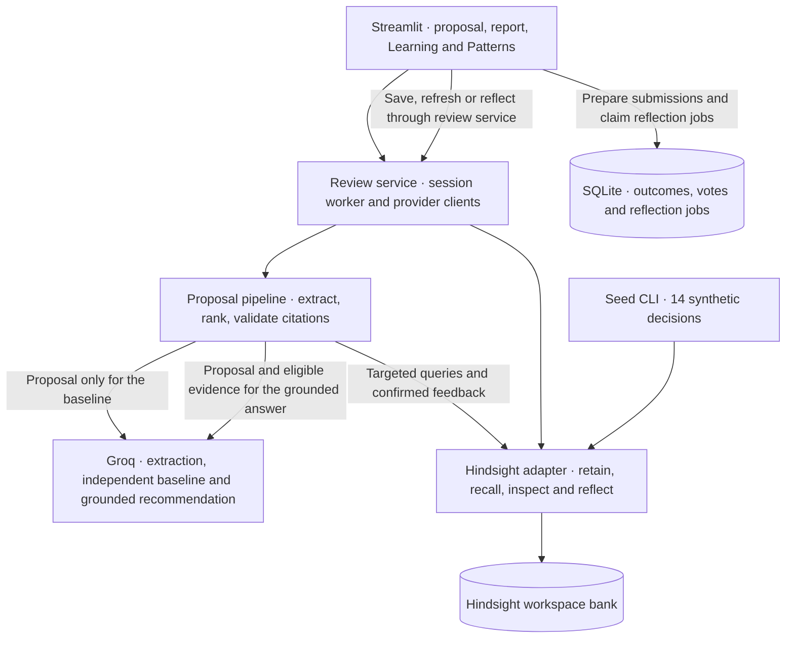
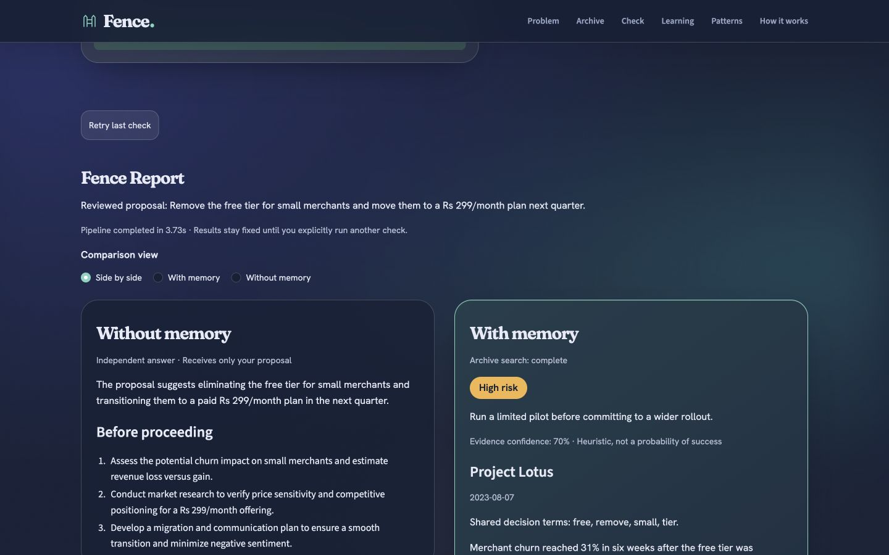

# Fence

Before you decide, ask what you have already tried.

Fence is an institutional-memory decision reviewer for Hack with Bengaluru 3.0. The proposal pipeline compares generic advice with advice grounded in earlier decisions using Hindsight and Groq. The Streamlit app submits real proposal reviews, compares independent and memory-backed answers, and displays the retrieved evidence alongside the illustrative decision archive.

Kaveri Pay is a **fictional** Bengaluru fintech with roughly 220 employees. Every archive decision, person, and business metric here is synthetic. The seed is illustrative history, not live feedback or evidence of real customer results.

## Quick start

Run the commands from the Fence app directory, where `app.py` and `requirements.txt` are located. In the parent hackathon workspace, enter it with `cd fence`. Use Python 3.11 or 3.13. The full suite was verified on Python 3.11.15 and 3.13.5 on macOS x86_64.

```bash
python3.11 -m venv .venv
source .venv/bin/activate
python -m pip install -r requirements.txt
python -m pip check
python -m seed.seed --dry-run
```

Reuse an existing environment if its dependencies are installed. For a uv environment without pip, use `uv pip check --python .venv/bin/python`. The dry run validates 14 unique synthetic decisions without contacting providers. To explore the archive locally, launch `python -m streamlit run app.py --server.address=127.0.0.1` and open <http://localhost:8501>. A live review requires Groq and Hindsight.

For live setup, create a private config file if one does not exist:

```bash
if [ ! -e .env ]; then
  cp .env.example .env
fi
chmod 600 .env
```

Set `GROQ_API_KEY` in `.env`, then configure either Hindsight Cloud or local Docker below. Keep credentials out of shared files and screenshots. Environment variables override `.env`. Restart Streamlit after changing settings or if an older server is still serving the draft-only interface.

## Hindsight Cloud

Create an organization at [Hindsight Cloud](https://ui.hindsight.vectorize.io/), then choose **Connect → Create API Key** and copy the key into `.env`. Set:

```dotenv
HINDSIGHT_BASE_URL=https://api.hindsight.vectorize.io
HINDSIGHT_API_KEY=
HINDSIGHT_BANK_ID=kaveri-pay
```

The blank key above must be populated privately. The documented Cloud base URL has no `/v1` suffix. Fence uses one memory bank per workspace; choose a different bank ID for another workspace. Cloud runs the memory-processing infrastructure and models. These settings follow the [official Cloud quick start](https://docs.hindsight.vectorize.io/cloud/getting-started/).

## Local Docker

This runs **Hindsight only**; Fence runs in the host Python environment. Stage 7D reviewed this configuration statically because Docker was unavailable. Fresh image startup and volume recovery are unverified. The `latest` tag is mutable; capture and pin a successfully tested image digest before a reproducible deployment. Do not expose these unauthenticated local ports publicly. Preserve both the named Hindsight volume and Fence's separate SQLite queue.

Install and start Docker, then put a valid `GROQ_API_KEY` in `.env`. The following command creates a private, ignored Docker environment file from that key without printing it:

```bash
python - <<'PY'
import os
from pathlib import Path
from dotenv import dotenv_values

key = os.environ.get("GROQ_API_KEY") or dotenv_values(".env").get("GROQ_API_KEY")
if not key or "\n" in key or "\r" in key:
    raise SystemExit("Set a valid GROQ_API_KEY in .env first.")
path = Path(".env.hindsight")
fd = os.open(path, os.O_WRONLY | os.O_CREAT | os.O_TRUNC, 0o600)
os.chmod(path, 0o600)
with os.fdopen(fd, "w") as output:
    output.write("HINDSIGHT_API_LLM_PROVIDER=groq\n")
    output.write("HINDSIGHT_API_LLM_MODEL=openai/gpt-oss-20b\n")
    output.write("HINDSIGHT_API_WORKER_ID=fence-local\n")
    output.write(f"HINDSIGHT_API_LLM_API_KEY={key}\n")
PY

docker run -d --pull always --name fence-hindsight \
  --restart unless-stopped --shm-size=1g --stop-timeout 75 \
  -p 127.0.0.1:8888:8888 -p 127.0.0.1:9999:9999 \
  --env-file .env.hindsight \
  -v fence-hindsight-data:/home/hindsight/.pg0 \
  ghcr.io/vectorize-io/hindsight:latest
```

Change the Fence settings in `.env` to:

```dotenv
HINDSIGHT_BASE_URL=http://localhost:8888
HINDSIGHT_API_KEY=
HINDSIGHT_BANK_ID=kaveri-pay
```

The default local server does not need a client API key. Its separate `HINDSIGHT_API_LLM_API_KEY` lets the server call Groq to process memories. The control plane is at [localhost:9999](http://localhost:9999). Give the first launch time to initialize the database and models before seeding. Restart an existing container with `docker start fence-hindsight`; the named volume preserves its data.

The image, volume path, ports, and shutdown allowance follow [official Docker installation](https://hindsight.vectorize.io/developer/installation#docker). Groq provider variables and model overrides follow [Hindsight model configuration](https://hindsight.vectorize.io/developer/models#groq). Hindsight recommends adequate Groq quota for retention; its memory processing uses a separate server-side call path from Fence's proposal-review requests.

## Seed and run

With either provider configured, seed a new or dedicated demo bank before opening the app for a live review. Run from the app directory with the environment active:

```bash
python -m seed.seed
python -m streamlit run app.py --server.address=127.0.0.1
```

Expect 14 distinct decision documents in a fresh seeded bank. Hindsight may extract several facts per document. Use **Use a sample proposal** and **Check this proposal** to generate the Lotus comparison. **Retry last check** requests a fresh review. Switching views keeps the current report in the browser session.

For optional live verification in a dedicated test bank, use `python -m seed.seed --verify-idempotency` to check reseeding, or `python -m scripts.check_memory` to retain and recall Lotus. Both can write to the selected bank. Reuse the existing seeded demo bank for presentation. The [60-second runbook](docs/DEMO.md) covers preparation, screenshots, and backup proposals.

## Configuration

| Variable | Default / purpose |
| --- | --- |
| `HINDSIGHT_BASE_URL` | `https://api.hindsight.vectorize.io`; use `http://localhost:8888` for Docker |
| `HINDSIGHT_API_KEY` | Required for Cloud; blank for the default local server |
| `HINDSIGHT_BANK_ID` | `kaveri-pay`, one bank per workspace |
| `HINDSIGHT_TIMEOUT_SECONDS` | `15`, timeout for an individual API attempt |
| `HINDSIGHT_OPERATION_TIMEOUT_SECONDS` | `90`, bounded wait for retain processing |
| `HINDSIGHT_MAX_ATTEMPTS` | `3`, maximum attempts for retryable failures |
| `HINDSIGHT_RETRY_MIN_SECONDS` | `0.5`, minimum retry delay |
| `HINDSIGHT_RETRY_MAX_SECONDS` | `2`, maximum retry delay |
| `HINDSIGHT_POLL_INTERVAL_SECONDS` | `1`, retain-status polling interval |
| `GROQ_API_KEY` | Required for live reviews and used by the optional Docker example |
| `GROQ_PRIMARY_MODEL` | `openai/gpt-oss-120b` |
| `GROQ_FALLBACK_MODEL` | `openai/gpt-oss-20b` |
| `GROQ_TIMEOUT_SECONDS` | `8`, time limit per request attempt |
| `GROQ_MAX_ATTEMPTS` | `2`, total attempts per model including the initial request |
| `OUTCOME_QUEUE_PATH` | `.data/outcomes.sqlite3` in the app directory. Use a durable, private location for deployment. |

Do not increase retries to hide authentication or configuration errors. Fix the key, endpoint, bank access, or model configuration first. Timeout failures are kept distinct from successful retrieval with no matches.

## How Hindsight memory is used

`core/memory.py` uses the official `hindsight-client` SDK. Decision records become natural-language source documents containing the proposal, owner, team, date, outcome, reasons, and impact. Contexts distinguish past decisions, outcome logs, and user feedback. Metadata and stable source references preserve provenance.

- **Retain:** stable document IDs identify decisions and events. Async requests also use stable operation IDs across retries; successful enqueueing is followed by bounded completion polling. This prevents lost acknowledgements from causing duplicate processing. Reseeding checks that the original retain completed before reporting an unchanged source. See [retain and idempotency](https://hindsight.vectorize.io/developer/api/retain) and [operation status](https://hindsight.vectorize.io/developer/api/operations).
- **Recall:** SDK results preserve fact IDs, source documents, evidence, dates where available, and retrieval information. Ranking signals are relative within a query, not calibrated confidence percentages. See [recall response semantics](https://hindsight.vectorize.io/developer/api/recall).
- **Reflect:** Fence verifies source text and groups before presenting recurring patterns. Reflection runs on request or after each three confirmed qualifying outcomes. See [reflect schema and evidence](https://hindsight.vectorize.io/developer/api/reflect).
- **Activity:** each session tracks operation attempts and their status without storing credentials in activity records. The report exposes request activity and distinguishes recalled facts from retained decision documents.

The [Python SDK documentation](https://hindsight.vectorize.io/sdks/python) documents client timeouts, `retain`, `recall`, `reflect`, and their async variants. [Document APIs](https://hindsight.vectorize.io/developer/api/documents) provide source-level inspection and counts. Hindsight stores confirmed source documents and events. SQLite preserves local submissions, acknowledgements, and reflection jobs across restarts.



See the [architecture guide](docs/ARCHITECTURE.md) for the review paths, citation checks, and persistence boundaries.

## Seed provenance and review

The checked-in JSON was generated by the coding assistant's language model, then editorially reviewed against the requested facts and validated locally. **No Groq generation call was made.** The seed command uses this file directly and requires no Groq access when using Hindsight Cloud. The required anchors are Project Lotus in Q3 2023, 31% churn in six weeks, support migration limits and a simultaneous competitor campaign; the rolled-back Instant Settlement launch and ₹38 lakh month-one chargebacks; the SMS switch's 91% tier-2 OTP delivery and three-week reversal; and a successful, measured, single-city QR soundbox pilot. Other records supply mixed outcomes across teams and years.

Illustrative archive records stay distinct from user-created outcome and feedback events.

## Groq wrapper and verification

`core/llm.py` provides async `chat` and `structured_chat` methods. Both use the official SDK with a deadline per attempt and bounded retries. Structured requests use best-effort JSON Schema and strict local Pydantic validation. The wrapper can remove an enclosing Markdown fence or a trailing comma before making another request. Both default models support this mode. [Groq model list](https://console.groq.com/docs/models) · [Groq structured outputs](https://console.groq.com/docs/structured-outputs)

From `fence/` with the virtual environment active and `GROQ_API_KEY` configured, run:

```bash
python -m scripts.check_groq
```

The command sends one small request per configured model with retries and fallback disabled. Expect a validation result and timing for each model. If an ID becomes unavailable, set `GROQ_PRIMARY_MODEL` or `GROQ_FALLBACK_MODEL` to a model with best-effort JSON Schema support and repeat the checks.

## Who pays and why

The buyer is a product, operations, or engineering leader—or chief of staff—at a company with 50–500 employees. They pay to reduce repeated mistakes when decision context is scattered across documents or leaves with staff. Fence makes the earlier outcome and its causes available at the moment someone proposes a similar change. The fictional Lotus example demonstrates the intended review experience; it is not a measured customer saving or ROI claim.

A customer could begin with a small, reviewed archive of decision notes and outcome summaries. **Future integrations** could ingest approved Slack threads, Notion decision records, or Confluence postmortems while preserving workspace access rules and source links. These connectors are not implemented.

## Screenshots and verification



[Mobile citation target](docs/qa/stage7b-mobile-evidence.jpg) · [Learning after restart](docs/qa/stage7b-desktop-learning.jpg) · [Reflection with supporting sources](docs/qa/stage7b-desktop-reflection.jpg)

These captures show the actual Streamlit app using synthetic QA data in an isolated bank. Stage 7A recorded 174 passing tests on each verified Python version. Stage 7B exercised live review, feedback, and reflection in Chrome at desktop and 360px mobile widths. For an offline test run, use `python -m pytest -q`. The [implementation tracker](docs/PROGRESS.md) records the full verification history.

## Hackathon handoff

Team members must download [Band AI desktop](https://band.ai/).

- Public repository URL — https://github.com/Shaad747/fence-hackathon
- Team members:
  - Mir Shaad Ali
  - Punith Dewangan

## Outcome persistence (Stage 6A)

After reviewing a proposal, choose a decision outcome and enter a reason in **Outcome feedback**, then select **Save outcome**. Accepted, Rejected, Modified, and Pending are supported alongside the original Approved, Shipped, and Failed states. Saving uses Hindsight only; it does not call Groq or change evidence ranking.

An immutable submission queue in `.data/outcomes.sqlite3` preserves the exact event ID, timestamp, proposal/report references, evidence IDs, and notes before a network write. Hindsight remains the confirmed memory store. Identical submissions deduplicate; different states or notes append records. A failed, cancelled, or interrupted write stays unconfirmed until an explicit retry receives a confirmed receipt. History and retry controls are available after a restart without rerunning proposal analysis. Confirmed history in this UI is the local queue's record of acknowledgements, not a fresh remote health check or a catalog of outcomes created by other deployments.

Keep the queue on durable storage; set `OUTCOME_QUEUE_PATH` for deployments with ephemeral app disks. Do not delete it while unconfirmed submissions remain. The default `.data/` directory is Git-ignored. A custom queue path should also be outside source control. This queue contains user proposal and outcome content, not API credentials. Restart the Streamlit process after updating modules; existing sessions may still have older imports.

## Confirmed relevance learning (Stage 6B)

In **Learning**, use **Relevant** or **Not relevant** for a cited lesson. A confirmed vote updates the chart; it never rewrites the current report or its citations. Use **Retry last check** to request a fresh review with the latest persisted feedback. Identical direction/proposal/evidence votes count once, including after report regeneration. Opposite votes are separate immutable events whose positive and negative signals average together; they are not silent edits to earlier votes.

The existing ranking adjustment is `0.1 × mean(+1 for Relevant, −1 for Not relevant)`, bounded to ±0.1 and applied only to eligible evidence. Base relevance and provenance gates still apply. Votes cannot promote irrelevant or inconsistent sources. The pipeline reads the complete tagged feedback source listing and verifies each retain operation completed; a failed read produces a visible issue and falls back to the unadjusted ranking, rather than inventing votes.

The chart shows chronological **Relevant votes / all confirmed vote events**, not model accuracy, causal improvement, or business success. Outcome counts include Pending decision records and are labeled accordingly. Local acknowledgements update immediately; **Refresh persisted feedback** explicitly reads other confirmed feedback in the configured bank. Ordinary widget reruns make no learning API calls. Refresh failures preserve the last known view with a stale-data warning. Failed/unconfirmed submissions have retry controls and do not enter the chart. The same durable queue now holds separate outcome and feedback tables.

`python -m scripts.check_learning` performs an optional live feedback/outcome persistence check in a new isolated `fence-verify-*` bank. It never calls Groq or writes to the configured demonstration bank. Verification records remain isolated for inspection. Source listing is deliberately exhaustive for the hackathon-sized bank; large banks may hit the existing pipeline deadline and require a scalable confirmed-event index. Reflection is described below.

## Grounded reflection (Stage 6C)

Select **What does our history say?** in Patterns. Fence verifies confirmed outcome sources, retrieves historical evidence, and asks Hindsight to select supported recurring themes. Each pattern displays exact source records and counts, an observed term recurrence, and a suggested lesson clearly distinguished from a causal conclusion. The catalog covers support, competitors, migration, pilots, and vendors. At least two distinct proposal/source groups must support a theme; zero, one, or two patterns are valid results. Historical seed evidence remains illustrative. No accuracy or business improvement is inferred.

Automatic reflection is scheduled once at 3, 6, 9, … confirmed qualifying outcome records. Accepted, Approved, Rejected, Modified, Shipped, and Failed records qualify; Pending decisions and unsuccessful writes do not. A failed business outcome is a valid recorded outcome, unlike a failed save. Duplicate submissions and relevance votes do not advance the count. Jobs, event identities, snapshots, and results persist in the existing queue database. Each rerun can execute one queued automatic job; it does not repeat a completed job.

Failed reflection leaves the outcome and previous successful result intact. Use **Retry reflection** explicitly. An interrupted worker becomes retryable after three minutes. Atomic claims prevent competing workers from completing the same job. A remote request interrupted before its local acknowledgement may be recomputed on explicit retry because Hindsight reflect supplies no application idempotency key; the scheduler does not silently retry that uncertainty. Durable shared queue storage is required across app restarts/processes. Other installations' outcome histories are not automatically imported for milestone counting.

Reflection reads the latest 12 qualifying local outcomes and at most 24 verified sources. Empty/insufficient histories avoid an unnecessary reflect call; unsupported source IDs or malformed structured output fail validation. Calls are bounded, and ordinary Streamlit reruns reuse persisted results. The UI shows uncertainty and limitations rather than inventing missing patterns.

For an optional live verification, run `python -m scripts.check_reflection`. It retains three synthetic outcomes in a new isolated `fence-reflect-verify-*` bank and sends one reflection request, without direct Groq calls or writes to the demonstration bank. Isolated records remain available for inspection. Restart Streamlit after updating modules. See `docs/PROGRESS.md` for the actual verification results and remaining Stage 7 checks.

## What Fence can’t do yet

Fence supports a trusted, single-workspace deployment. Public deployment requires an access layer and a durable, private queue path. The local SQLite file contains business content. The supplied fictional archive demonstrates the workflow. Live results depend on recall, source quality, and provider availability. See the [architecture guide](docs/ARCHITECTURE.md) for storage and retry boundaries.
